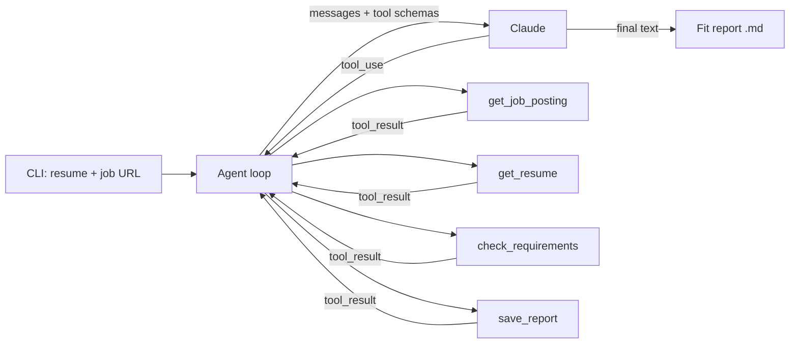

# Job-Fit Agent

A small tool-calling LLM agent that reads a job posting and my resume, checks
which requirements the resume actually supports, and writes a fit report with
a score, honest gaps, and tailored resume bullets that cite their source lines.

I built it during my own job search. I wanted something that tells me when a
role is a long shot instead of flattering me, and that never invents experience
when it rewrites bullets.

## How it works



1. The CLI loads the resume and the posting (local file or URL).
2. The agent loop sends Claude the goal, a system prompt and four tool schemas.
3. Claude decides which tools to call and in what order. The loop runs each
   call in Python and sends the result back, matched by `tool_use_id`.
4. The loop repeats until Claude stops asking for tools, then the report is
   saved to `reports/`.

| Tool | What it does |
|---|---|
| `get_job_posting` | Returns the posting as plain text (HTML stripped). |
| `get_resume` | Returns the resume with line numbers, so bullets can cite `(L12)`. |
| `check_requirements` | Plain code, no LLM: checks which extracted terms literally appear in the resume and on which lines. |
| `save_report` | Writes the final Markdown report. |

## Design decisions

- **The model extracts, code verifies.** Claude pulls requirements out of the
  posting, but a deterministic check decides what the resume literally
  contains. That gives the model evidence to reason from instead of a vibe.
- **Honesty over encouragement.** The system prompt forbids invented
  experience, requires a line citation for every tailored bullet, and asks for
  gaps to be stated plainly.
- **Narrow tools, no raw file or network access.** The person running the CLI
  picks the resume and posting. The model can only read those, not browse or
  open arbitrary files.
- **Errors go back to the model.** A malformed tool call returns an
  `is_error` result so the model can correct itself, instead of crashing.
- **A hard turn limit** (12) stops a confused model from looping.
- **Testable without an API key.** The tests swap in a scripted fake client,
  so the real loop and tools run offline in CI.

## Run it

Requires Python 3.10+ and an Anthropic API key.

```bash
pip install -r requirements.txt
export ANTHROPIC_API_KEY=your-key-here

python -m job_fit_agent --resume examples/sample_resume.md --job examples/sample_job.md
# or point it at a live posting
python -m job_fit_agent --resume my_resume.md --job "https://example.com/careers/123" --name acme-staff-designer
```

Use `--model` to pick a different Claude model. Check the
[Anthropic docs](https://docs.claude.com) for current model names.

Your own resume and generated reports are in `.gitignore`, so they stay off GitHub.

## Test it

```bash
pip install pytest
python -m pytest -q
```

## Known limitations

- `check_requirements` is literal matching: "design systems" won't match
  "design system", and synonyms aren't caught. The model is told to explain
  transferable evidence in those cases.
- Some career sites render postings with JavaScript, so URL fetching may return
  little text. Save the posting to a `.md` file and pass that instead.
- The score is the model's judgement against a rubric, not a calibrated
  probability of getting an interview.

## Ideas for next steps

- Expose the tools as an MCP server so any MCP client can use them.
- Batch mode: rank a folder of postings by fit.
- Stem or fuzzy-match terms in `check_requirements`.

## License

MIT
